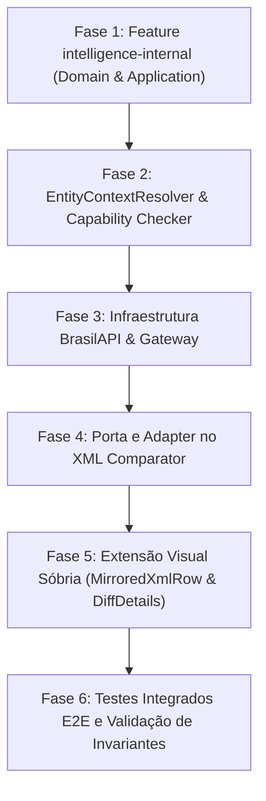

# Relatório Técnico de Análise de Impacto Arquitetural: Integração XML Comparator ↔ intelligence-internal

> **Documento Soberano de Análise de Engenharia**  
> **Data**: 2026-10-06  
> **Status**: CONCLUÍDO (Somente Análise — Nenhuma alteração de código ou criação de feature executada)  
> **Workspace**: `WorkTools2` (`labtool`)  
> **Alvo de Integração**: `labtool/src/features/xml-comparator` ↔ `labtool/src/features/intelligence-internal`

---

## 1. Resumo Executivo

O presente documento consolida o mapeamento arquitetural e a avaliação de impacto para a futura integração entre a feature existente [`xml-comparator`](../labtool/src/features/xml-comparator) e a nova feature independente [`intelligence-internal`](../labtool/src/features/intelligence-internal).

A premissa basilar do projeto é manter os motores **rigorosamente desacoplados**:
1. O **XML Comparator** é soberano na identificação, classificação semântica e exibição visual sincronizada/espelhada de diferenças entre dois documentos XML fiscais (Aprovado vs Rejeitado). Ele **não deve** acumular regras cadastrais, validações tributárias ou conhecimento sobre provedores externos (BrasilAPI).
2. A nova feature **intelligence-internal** será responsável por interpretar contexto cadastral/fiscal sob demanda explícita, realizar validações de integridade (CNPJ, CEP, CNAE, UF, Município) e orquestrar acessos a provedores cadastrais externos via camada de infraestrutura.
3. A integração ocorrerá por meio de um **contrato de integração neutro (Port & Adapter)** no Comparator, expondo uma verificação determinística síncrona/local de capacidade (`checkCapability`) e um acionamento assíncrono explicitado pelo usuário (`validate`).
4. **Isolamento de Entidade e Lado**: Cada linha divergente pertence estritamente a um dos lados da comparação (`approved` ou `rejected`). O contexto cadastral do XML aprovado **nunca** poderá ser reaproveitado ou misturado para interpretar o XML rejeitado, e vice-versa.

---

## 2. Escopo Analisado

A análise cobriu 100% dos artefatos da feature `xml-comparator`, seus testes automatizados e o padrão arquitetural já estabelecido em features irmãs (`cnpj-intelligence` e `xml-sanitizer`):

- **Domínio do Comparator**: [`comparison.types.ts`](../labtool/src/features/xml-comparator/domain/comparison.types.ts), [`export.types.ts`](../labtool/src/features/xml-comparator/domain/export.types.ts), [`domain/index.ts`](../labtool/src/features/xml-comparator/domain/index.ts).
- **Aplicação do Comparator**: [`comparator-parser.ts`](../labtool/src/features/xml-comparator/application/comparator-parser.ts), [`xml-differ.ts`](../labtool/src/features/xml-comparator/application/xml-differ.ts), [`diff-classifier.ts`](../labtool/src/features/xml-comparator/application/diff-classifier.ts), [`diff-context.ts`](../labtool/src/features/xml-comparator/application/diff-context.ts), [`markdown-exporter.ts`](../labtool/src/features/xml-comparator/application/markdown-exporter.ts), [`export-sanitizer.ts`](../labtool/src/features/xml-comparator/application/export-sanitizer.ts).
- **Catálogo**: [`export-sensitive-fields.ts`](../labtool/src/features/xml-comparator/catalog/export-sensitive-fields.ts).
- **Apresentação do Comparator**: [`XmlComparatorView.tsx`](../labtool/src/features/xml-comparator/presentation/XmlComparatorView.tsx), [`MirroredXmlViewer.tsx`](../labtool/src/features/xml-comparator/presentation/MirroredXmlViewer.tsx), [`MirroredXmlRow.tsx`](../labtool/src/features/xml-comparator/presentation/MirroredXmlRow.tsx), [`mirrored-rows.ts`](../labtool/src/features/xml-comparator/presentation/mirrored-rows.ts), [`ComparatorDiffDetails.tsx`](../labtool/src/features/xml-comparator/presentation/ComparatorDiffDetails.tsx), [`ComparatorSummary.tsx`](../labtool/src/features/xml-comparator/presentation/ComparatorSummary.tsx), [`ComparatorUploadArea.tsx`](../labtool/src/features/xml-comparator/presentation/ComparatorUploadArea.tsx).
- **Suíte de Testes**: 12 arquivos de teste em `labtool/tests/features/xml-comparator/`.
- **Arquitetura de Referência (Gateways & BrasilAPI)**: `labtool/src/features/cnpj-intelligence/infrastructure/brasil-api.client.ts`.

---

## 3. Arquitetura Atual do XML Comparator

O XML Comparator é organizado segundo os preceitos de Clean Architecture em quatro camadas bem delimitadas:

```
src/features/xml-comparator/
├── domain/            → Modelos e tipos puros semânticos de divergência e arquivos (zero deps)
├── catalog/           → Dicionários de tags sensíveis para higienização de exportação
├── application/       → Parsers, motor de diff (xml-differ), classificação semântica e resolução de contexto
└── presentation/      → Componentes React (visualizador espelhado, grid side-by-side, detalhes e upload)
```

### Invariantes Atuais:
1. **Representação Hierárquica Normalizada**: `ComparatorXmlNode` preserva o `path` posicional 1-based canônico (ex.: `/NFSe[1]/infDPS[1]/toma[1]/end[1]/CEP[1]`), `tag`, `localName`, `attributes` e `text`.
2. **Separação de Linhas Formatas**: `formatXmlToLines` converte a árvore em `FormattedLine[]`, onde cada linha contém seu `text` e o `path` posicional canônico associado.
3. **Alinhamento Espelhado (Mirrored)**: `buildMirroredRows` executa algoritmo LCS (Longest Common Subsequence) alinhando as linhas do Aprovado e do Rejeitado em `MirroredComparisonRow[]`. Linhas sem paridade geram slots vazios (`null`), garantindo que a rolagem seja perfeitamente sincronizada em um único container de scroll.

---

## 4. Fluxo Atual da Comparação

O ciclo de vida de uma comparação decorre nas seguintes etapas:

```text
Upload (Arquivos Aprovado & Rejeitado)
        ↓
formatXmlToLines()          → approvedLines, rejectedLines (FormattedLine[])
        ↓
loadComparatorTree()        → approvedTree, rejectedTree (ComparatorXmlNode)
        ↓
compareXmlTrees()           → XmlComparisonResult (diffs[], summary)
        ↓
buildMirroredRows()         → mirroredRows[] (alinhamento LCS de linhas com diffs por path)
        ↓
XmlComparatorView (State)   → selectedDiffId, selectedRowId
        ↓
MirroredXmlViewer           → Renderiza MirroredXmlRow[] (destaque e badges)
        ↓
ComparatorDiffDetails       → resolveDiffContext() exibe valores, nós pais e caminhos
```

### Detalhamento das Etapas:
1. **Onde nasce uma divergência**: Dentro de [`xml-differ.ts`](../labtool/src/features/xml-comparator/application/xml-differ.ts) nas funções `diffAttributes`, `compareNodes` e `classifyValueDiff` (via [`diff-classifier.ts`](../labtool/src/features/xml-comparator/application/diff-classifier.ts)).
2. **Onde é armazenada**: No array `comparisonResult.diffs: XmlComparisonDiff[]` mantido no estado do [`XmlComparatorView.tsx`](../labtool/src/features/xml-comparator/presentation/XmlComparatorView.tsx).
3. **Onde é selecionada**: Via `handleSelectRow` ou `handleSelectDiffById` no [`XmlComparatorView.tsx`](../labtool/src/features/xml-comparator/presentation/XmlComparatorView.tsx) ao clicar em uma linha ou no resumo.
4. **Onde é renderizada**: Em [`MirroredXmlRow.tsx`](../labtool/src/features/xml-comparator/presentation/MirroredXmlRow.tsx), onde a célula esquerda desenha o Aprovado e a célula direita o Rejeitado.
5. **Onde é detalhada**: Em [`ComparatorDiffDetails.tsx`](../labtool/src/features/xml-comparator/presentation/ComparatorDiffDetails.tsx), alimentada por `diffContext` gerado por [`diff-context.ts`](../labtool/src/features/xml-comparator/application/diff-context.ts).

---

## 5. Mapa dos Arquivos Relevantes do XML Comparator

| Arquivo | Responsabilidade Atual | Principais Dependências | Consumidor | Status | Intensidade da Mudança |
| :--- | :--- | :--- | :--- | :--- | :--- |
| [`comparison.types.ts`](../labtool/src/features/xml-comparator/domain/comparison.types.ts) | Tipos puros de divergência, resumo e linhas formatadas. | Zero | Toda a feature | `[MANTER — SEM ALTERAÇÃO]` | NENHUMA |
| [`export.types.ts`](../labtool/src/features/xml-comparator/domain/export.types.ts) | Tipos do relatório exportado em Markdown. | Zero | exporter, sanitizer | `[MANTER — SEM ALTERAÇÃO]` | NENHUMA |
| [`comparator-parser.ts`](../labtool/src/features/xml-comparator/application/comparator-parser.ts) | DOMParser, guards XXE, construção de árvore e linhas. | `DOMParser`, `domain` | differ, view | `[MANTER — SEM ALTERAÇÃO]` | NENHUMA |
| [`xml-differ.ts`](../labtool/src/features/xml-comparator/application/xml-differ.ts) | Motor de comparação e diff estrutural. | `domain`, `comparator-parser`, `diff-classifier` | view | `[MANTER — SEM ALTERAÇÃO]` | NENHUMA |
| [`diff-classifier.ts`](../labtool/src/features/xml-comparator/application/diff-classifier.ts) | Classificação semântica (Contextual vs Principal). Define escopos (`TOMADOR_SCOPES`, `PRESTADOR_SCOPES`). | `domain` | differ | `[MANTER — SEM ALTERAÇÃO]` | NENHUMA |
| [`diff-context.ts`](../labtool/src/features/xml-comparator/application/diff-context.ts) | Resolução de linhas visuais e `parentPath`. | `domain` | view | `[MANTER — SEM ALTERAÇÃO]` | NENHUMA |
| [`mirrored-rows.ts`](../labtool/src/features/xml-comparator/presentation/mirrored-rows.ts) | Alinhamento LCS de linhas espelhadas. | `domain` | view, viewer | `[MANTER — SEM ALTERAÇÃO]` | NENHUMA |
| [`MirroredXmlViewer.tsx`](../labtool/src/features/xml-comparator/presentation/MirroredXmlViewer.tsx) | Container e scroll do visualizador espelhado. | `domain`, `MirroredXmlRow` | view | `[ALTERAR]` (apenas repasse de props de ação/validação) | BAIXA |
| [`MirroredXmlRow.tsx`](../labtool/src/features/xml-comparator/presentation/MirroredXmlRow.tsx) | Renderização das células individuais Aprovado/Rejeitado. | React, `domain`, `mirrored-rows` | viewer | `[ALTERAR]` (inserção do slot para o botão `Validar [TAG]`) | MÉDIA |
| [`ComparatorDiffDetails.tsx`](../labtool/src/features/xml-comparator/presentation/ComparatorDiffDetails.tsx) | Painel inferior com detalhes da divergência. | React, `domain`, `diff-context` | view | `[ALTERAR]` (espaço opcional para resultado detalhado da validação) | BAIXA |
| [`XmlComparatorView.tsx`](../labtool/src/features/xml-comparator/presentation/XmlComparatorView.tsx) | Orquestrador React de estado e fluxo. | React, application, presentation | Next.js Page | `[ALTERAR]` (estado de validação e dispatch de requisições) | MÉDIA |
| [`export-sanitizer.ts`](../labtool/src/features/xml-comparator/application/export-sanitizer.ts) | Higienização de dados para exportação. | `catalog` | exporter | `[MANTER — SEM ALTERAÇÃO]` | NENHUMA |
| [`markdown-exporter.ts`](../labtool/src/features/xml-comparator/application/markdown-exporter.ts) | Geração de relatório Markdown. | `domain`, `export-sanitizer` | view | `[MANTER — SEM ALTERAÇÃO]` | NENHUMA |

---

## 6. Modelo Atual de Divergência

A interface [`XmlComparisonDiff`](../labtool/src/features/xml-comparator/domain/comparison.types.ts#L54-L78) possui atualmente a seguinte definição:

```typescript
export interface XmlComparisonDiff {
  id: string;                      // ex.: "VALUE_DIFF:/NFSe[1]/infDPS[1]/toma[1]/end[1]/CEP[1]"
  kind: DiffKind;                  // "ONLY_IN_APPROVED" | "ONLY_IN_REJECTED" | "VALUE_DIFF" | "ATTRIBUTE_DIFF" | "STRUCTURE_DIFF" | "CONTEXTUAL_DIFF"
  path: string;                    // ex.: "/NFSe[1]/infDPS[1]/toma[1]/end[1]/CEP[1]"
  tag: string;                     // ex.: "CEP"
  approvedValue: string | null;    // ex.: "85900000"
  rejectedValue: string | null;    // ex.: "85901000"
  attributes?: AttributeDiffDetail[];
  detail: string;                  // ex.: "Divergência contextual no elemento <CEP>."
}
```

A linha espelhada [`MirroredComparisonRow`](../labtool/src/features/xml-comparator/presentation/mirrored-rows.ts#L23-L44) possui:
- `id: string`
- `path: string | null`
- `approved: FormattedLine | null` (com `text` e `path`)
- `rejected: FormattedLine | null` (com `text` e `path`)
- `approvedLineNumber: number | null`
- `rejectedLineNumber: number | null`
- `diffs: XmlComparisonDiff[]`

---

## 7. Levantamento de Dados Estruturais Disponíveis e Ausentes

### Dados Já Disponíveis (100% Prontos para Uso):
1. **Nome da Tag**: `diff.tag` e no texto da linha formatada (`<CEP>85900000</CEP>`).
2. **Caminho Canônico Completo (`xmlPath`)**: `diff.path` (ex.: `/NFSe[1]/infDPS[1]/toma[1]/end[1]/CEP[1]`).
3. **Cadeia de Ancestrais no Path**: O `diff.path` é estritamente hierárquico e segmentado (`split("/")`), permitindo identificar os nós pais (`infDPS`, `toma`, `end`).
4. **Nó Pai Imediato**: Já resolvido por `getParentPath(diff.path)` em `diff-context.ts`.
5. **Valor no Aprovado**: `diff.approvedValue`.
6. **Valor no Rejeitado**: `diff.rejectedValue`.
7. **Lado da Linha**: Em `MirroredXmlRow`, a célula esquerda opera exclusivamente sobre `row.approved` e a direita sobre `row.rejected`.
8. **Tipo da Divergência**: `diff.kind`.

### Dados Parcialmente Disponíveis:
1. **Escopo Semântico Pai**: Já existem conjuntos de tags normalizadas em `diff-classifier.ts` (`TOMADOR_SCOPES`, `PRESTADOR_SCOPES`). No entanto, o `diff-classifier` utiliza esses conjuntos apenas para decidir se o diff é `CONTEXTUAL_DIFF` ou `VALUE_DIFF`. Ele não expõe um objeto estruturado de entidade (`entityRole: "TOMADOR" | "PRESTADOR" | "EMITENTE"`).
2. **Valor em nós com formatação complexa**: Se a tag tiver atributos além do valor (ex.: `<CEP tipo="principal">85900000</CEP>`), `diff.approvedValue` guarda apenas o texto extraído, o que é perfeito para validações cadastrais.

### Dados Ausentes (Precisarão Ser Criados/Providos na Integração):
1. **Contrato de Contexto Cadastral do Alvo (`ValidationTargetContext`)**:
   - Falta uma estrutura que una:
     - `tag: string` (ex.: "CEP")
     - `value: string` (ex.: "85900000")
     - `side: "APPROVED" | "REJECTED"`
     - `path: string`
     - `entityRole: "TOMADOR" | "PRESTADOR" | "EMITENTE" | "INTERMEDIARIO" | "OUTRO" | "UNKNOWN"`
     - `entityContext: Record<string, string | undefined>` (dados correlatos da mesma entidade no mesmo lado, ex.: CNPJ do tomador se o alvo for o CEP do tomador).
2. **Registro de Capacidades (`ValidationCapability`)**: Nenhuma estrutura atual diz se a tag `CEP` ou `CNPJ` é validável.
3. **Estado de Execução de Validação (React State)**: O Comparator não possui estado para armazenar status assíncrono de consulta (`idle`, `loading`, `success`, `error`), cache de resultado ou dados retornados pela validação externa.

---

## 8. Contexto da Entidade: Tomador, Prestador e Emitente

### Onde resolver a entidade?
A resolução de entidade deve obedecer ao princípio de responsabilidade única:
- **xml-comparator**: Fornece o contexto estrutural puro: o caminho hierárquico da tag (`xmlPath`), o valor textual e o lado (`side`).
- **Camada de Integração do Comparator (`comparator-intelligence-adapter.ts`)**: Faz a ponte entre a estrutura do XML e o domínio da inteligência.
- **intelligence-internal (`EntityContextResolver`)**: É a **autoridade responsável** por classificar a entidade com base nos segmentos do path e nos padrões fiscais (NFe, NFSe, CTe).

```
[Comparator]                              [intelligence-internal]
Fornece: (tag, value, xmlPath, side) ──►  EntityContextResolver:
                                          Analisa ancestrais do path
                                          Identifica se é TOMADOR/PRESTADOR/EMITENTE
                                          Extrai entidades correlatas do mesmo lado
```

### Risco Crítico: Diversidade de Padrões de NFS-e e NFe
No Brasil, não existe um padrão único de NFS-e:
- **Padrão Nacional (SND / infDPS)**: usa `toma` e `emit`.
- **Padrão ABRASF (v1 / v2)**: usa `TomadorServico`, `PrestadorServico`, `IdentificacaoTomador`.
- **Padrões Próprios (DSF, Betha, Ginfes, Curitiba, SP, RJ)**: usam `Tomador`, `Prestador`, `Destinatario`, `Remetente`.
- **NF-e / CT-e**: usa `dest`, `emit`, `rem`, `exped`.

**Documentação do Risco**: Se o Comparator tentasse resolver isso internamente em seu domínio, ele violaria a Clean Architecture ao se poluir com centenas de variações de layouts tributários municipais. Esse conhecimento **pertence exclusivamente à feature `intelligence-internal`**.

---

## 9. Arquitetura da Camada de Comunicação no Comparator

Para evitar que componentes visuais conheçam a `intelligence-internal`, propõe-se um padrão **Port & Adapter (Hexagonal)** interno ao Comparator:

```text
src/features/xml-comparator/
├── application/
│   └── ports/
│       └── comparator-intelligence.port.ts   [NOVO CONTRATO]
├── infrastructure/
│   └── internal-intelligence.adapter.ts      [NOVO ADAPTER]
└── presentation/
    ├── hooks/
    │   └── useComparatorIntelligence.ts       [NOVO HOOK]
    └── components/
        └── ValidateTagAction.tsx              [NOVO COMPONENTE VISUAL]
```

### Por que esta abordagem?
1. **Desacoplamento Completo**: Os componentes visuais do Comparator (`MirroredXmlRow`, `XmlComparatorView`) interagem apenas com uma interface neutra (`ComparatorIntelligencePort`) via hook React.
2. **Testabilidade**: Nos testes unitários do Comparator, pode-se injetar um mock imediato da porta (`MockComparatorIntelligencePort`) sem carregar módulos de inteligência ou fazer mock de rede.
3. **Substituibilidade**: Se no futuro houver outro mecanismo de inteligência, o Comparator não sofrerá nenhuma alteração estrutural.

---

## 10. Capability Check vs. Validação Efetiva

A separação entre checagem de capacidade e validação efetiva é mandatória:

```mermaid
flowchart TD
    A["Linha com Divergência Renderizada"] --> B["checkCapability(tag, path, side)"]
    B -->|Síncrono / O(1) / Local| C{"Tem capacidade?"}
    C -->|Não| D["Renderiza linha normalmente"]
    C -->|Sim| E["Exibe botão: Validar Tag"]
    E --> F["Usuário clica no botão"]
    F -->|Ação Explícita| G["validate(request)"]
    G -->|Assíncrono| H["intelligence-internal"]
    H --> I["Retorna ValidationResult"]
```

### 1. `checkCapability(input: CapabilityCheckInput): CapabilityCheckResult`
- **Execução**: Síncrona, determinística, 100% local, < 1ms, zero I/O, zero HTTP.
- **Entrada**:
  ```typescript
  interface CapabilityCheckInput {
    tag: string;         // ex.: "CEP", "CNPJ", "CNAE"
    path: string;        // ex.: "/NFSe[1]/infDPS[1]/toma[1]/end[1]/CEP[1]"
    side: "approved" | "rejected";
    value: string | null;
  }
  ```
- **Saída**:
  ```typescript
  interface CapabilityCheckResult {
    canValidate: boolean;
    targetType?: "CEP" | "CNPJ" | "CNAE";
    label?: string; // ex.: "Validar CEP", "Validar CNPJ"
  }
  ```

### 2. `validate(request: ValidationRequest): Promise<ValidationResult>`
- **Execução**: Assíncrona, acionada **exclusivamente** pelo clique do usuário.
- **Entrada**:
  ```typescript
  interface ValidationRequest {
    tag: string;
    value: string;
    path: string;
    side: "approved" | "rejected";
    fullXmlSource?: string; // Para resolução de contexto correlato da entidade
  }
  ```

---

## 11. Componente Visual e Ponto de Inserção: `Validar [TAG]`

### Localização Exata no Código Atual
No arquivo [`MirroredXmlRow.tsx`](../labtool/src/features/xml-comparator/presentation/MirroredXmlRow.tsx):
- **Célula Esquerda (Aprovado)**: linhas 196–268.
- **Célula Direita (Rejeitado)**: linhas 271–343.

Ambas as células possuem uma estrutura flex:
```tsx
<div style={{ display: "flex", alignItems: "flex-start", ... }}>
  <span>{/* Número da Linha */}</span>
  <code>{/* Conteúdo XML formatado */}</code>
  {/* Badge de tipo de diff */}
</div>
```

### Proposta de Extensão Visual (Baixo Acoplamento):
Inserir um slot de ação no final da célula, logo após o conteúdo do código ou adjacente ao badge:
```tsx
{/* Célula Aprovado */}
{approvedCapability?.canValidate && (
  <ValidateTagAction
    label={approvedCapability.label}
    onClick={(e) => {
      e.stopPropagation(); // Não alternar seleção da row
      onValidate({ side: "approved", tag: row.diffs[0].tag, value: row.approved.text, path: row.path });
    }}
  />
)}
```

**Por que não alterar profundamente `MirroredXmlRow`?**
O componente `MirroredXmlRow` é crítico para a renderização de alto desempenho de documentos com centenas de linhas. A criação de um subcomponente leve `ValidateTagAction` evita re-renderizações custosas e mantém a estilização contida (seguindo o padrão Catppuccin Mocha, tamanho sóbrio, fonte mono, sem layout quebrado).

---

## 12. Independência Estrita entre XML Aprovado e XML Rejeitado

> [!CAUTION]
> **REGRA INVIOLÁVEL DE SEGURANÇA E DOMÍNIO:**  
> O XML aprovado e o XML rejeitado são documentos legal e faticamente distintos.  
> Uma divergência pode decorrer de emissores ou tomadores diferentes.  
> **É terminantemente proibido utilizar dados cadastrais do XML aprovado para validar informações do XML rejeitado, ou vice-versa.**

### Análise de Risco no Estado Atual do Comparator:
No Comparator atual, cada linha do `MirroredComparisonRow` mantém:
- `row.approved: FormattedLine | null` (pertence exclusivamente ao Aprovado);
- `row.rejected: FormattedLine | null` (pertence exclusivamente ao Rejeitado).

**Risco Identificado**: A interface `XmlComparisonDiff` agrupa em um mesmo objeto `approvedValue` e `rejectedValue`.
Se a camada de validação recebesse apenas o objeto `diff`, ela poderia ser tentada a correlacionar os valores.
**Mitigação Arquitetural**: A chamada de validação deve ser **estritamente parametrizada pelo lado (`side: "approved" | "rejected"`)**, garantindo que a consulta seja isolada:
- Botão na coluna esquerda -> dispara requisição contendo `side: "approved"` e `value: row.approved.text`.
- Botão na coluna direita -> dispara requisição contendo `side: "rejected"` e `value: row.rejected.text`.

---

## 13. Exibição do Resultado da Validação

### Onde exibir o resultado?
Foram avaliadas duas opções:
1. **Inline na própria linha**: Poluiria o grid espelhado e quebraria o alinhamento de altura entre as colunas do CSS Grid.
2. **No painel inferior [`ComparatorDiffDetails.tsx`](../labtool/src/features/xml-comparator/presentation/ComparatorDiffDetails.tsx)**: **Recomendado**.

O `ComparatorDiffDetails` já é o local canônico do LabTool para exibir detalhes da divergência selecionada, exibindo as caixas "Valor no XML Aprovado" e "Valor no XML Rejeitado".
Abaixo dessas caixas, pode ser incluída uma seção dedicada:
```
┌────────────────────────────────────────────────────────┐
│ 🔍 VALIDAÇÃO CADASTRAL EXTERNA                         │
│ Lado: XML Rejeitado | Entidade: Tomador                │
│ Valor: 85901000 | Status: Válido (BrasilAPI)          │
│ Logradouro: Rua Santos Dumont | Bairro: Centro         │
│ Município: Toledo - PR | CEP Oficial: 85901-000        │
└────────────────────────────────────────────────────────┘
```

---

## 14. Proposta da Nova Feature: `intelligence-internal`

A futura feature deve ser criada como um módulo independente de Clean Architecture em `src/features/intelligence-internal/`:

```text
src/features/intelligence-internal/
├── domain/
│   ├── entity-context.types.ts       [Tipos de Entidade: TOMADOR, PRESTADOR, EMITENTE, UNKNOWN]
│   ├── validation-capability.types.ts [Contratos de checagem de capacidade]
│   └── validation-result.types.ts    [Resultado consolidado de validação]
│
├── application/
│   ├── entity-context-resolver.ts    [Mapeia path e XML para identificar a entidade]
│   ├── capability-checker.ts         [Verifica deterministicamente se a tag é validável]
│   ├── validators/
│   │   ├── cep-validator.usecase.ts  [Valida regras e orquestra busca de CEP]
│   │   ├── cnpj-validator.usecase.ts [Valida regras de CNPJ e consulta gateway]
│   │   └── cnae-validator.usecase.ts [Compara CNAE com atividades do CNPJ da entidade]
│   └── ports/
│       └── cadastral-gateway.port.ts [Interface neutra de gateway cadastral]
│
├── infrastructure/
│   ├── brasil-api/
│   │   ├── brasil-api-cadastral.client.ts [Cliente HTTP defensivo BrasilAPI]
│   │   └── brasil-api-cadastral.mapper.ts [Mapeador de DTOs externos para Domain]
│   └── memory/
│       └── cached-cadastral.gateway.ts    [Cache em memória para evitar rate limit 429]
│
└── index.ts                          [Fachada pública e contratos de integração da feature]
```

### Camadas e Responsabilidades:
1. **Domain**: Invariantes e contratos puros. Zero dependências de React ou HTTP.
2. **Application**: Casos de uso (`cep-validator`, `cnpj-validator`, `cnae-validator`, `entity-context-resolver`).
3. **Infrastructure**: Implementação do `cadastral-gateway.port.ts` utilizando a BrasilAPI. Já existe um cliente modelo em `cnpj-intelligence/infrastructure/brasil-api.client.ts` que pode ser reutilizado ou adaptado.
4. **Presentation**: Componente de feedback ou visualização do resultado cadastral.

---

## 15. Fronteira Arquitetural e Fluxo de Comunicação

```text
[ XML Comparator ]                                       [ intelligence-internal ]
─────────────────                                       ─────────────────────────
MirroredXmlRow (UI)
        │
        ▼
useComparatorIntelligence (Hook)
        │
        ▼
ComparatorIntelligencePort (Interface)
        │
        ▼
InternalIntelligenceAdapter (Adapter) ─────────────────► IntelligenceFacade (API Pública)
                                                                    │
                                                                    ▼
                                                            Application Use Cases
                                                            (EntityResolver & Validators)
                                                                    │
                                                                    ▼
                                                            CadastralGateway (Port)
                                                                    │
                                                                    ▼
                                                            BrasilApiClient (Infra)
                                                                    │
                                                                    ▼
                                                            BrasilAPI Externa
```

---

## 16. Mapas de Dependências

### Mapa Atual:
```
XmlComparatorView
    ├── comparator-parser
    ├── xml-differ
    │       └── diff-classifier
    ├── diff-context
    ├── markdown-exporter
    │       └── export-sanitizer
    ├── ComparatorSummary
    ├── MirroredXmlViewer
    │       └── MirroredXmlRow
    └── ComparatorDiffDetails
```

### Mapa Proposto:
```
XmlComparatorView
    ├── (mesmas dependências do motor de comparação atual)
    ├── useComparatorIntelligence (Hook)
    │       └── ComparatorIntelligencePort (Port local)
    │               ▲
    │               │ (implementado por)
    │       InternalIntelligenceAdapter (Adapter local do Comparator)
    │               │
    │               ▼
    │       intelligence-internal (Fachada Pública da nova feature)
    │               ├── EntityContextResolver
    │               ├── CapabilityChecker
    │               ├── Validators (CEP, CNPJ, CNAE)
    │               └── CadastralGateway ──► BrasilApiClient ──► [BrasilAPI]
    │
    ├── MirroredXmlViewer ──► MirroredXmlRow ──► ValidateTagAction
    └── ComparatorDiffDetails ──► CadastralValidationResultCard
```

---

## 17. Classificação Completa dos Arquivos

| Caminho | Status | Responsabilidade | Alteração Prevista | Risco |
| :--- | :--- | :--- | :--- | :--- |
| `src/features/xml-comparator/domain/comparison.types.ts` | `[MANTER — SEM ALTERAÇÃO]` | Tipos do domínio de comparação | Nenhuma alteração | BAIXO |
| `src/features/xml-comparator/application/comparator-parser.ts` | `[MANTER — SEM ALTERAÇÃO]` | Parsing de XML e geração de linhas | Nenhuma alteração | BAIXO |
| `src/features/xml-comparator/application/xml-differ.ts` | `[MANTER — SEM ALTERAÇÃO]` | Algoritmo principal de diff | Nenhuma alteração | BAIXO |
| `src/features/xml-comparator/application/diff-classifier.ts` | `[MANTER — SEM ALTERAÇÃO]` | Classificação semântica de diff | Nenhuma alteração | BAIXO |
| `src/features/xml-comparator/application/diff-context.ts` | `[MANTER — SEM ALTERAÇÃO]` | Resolução de contexto de linhas | Nenhuma alteração | BAIXO |
| `src/features/xml-comparator/presentation/mirrored-rows.ts` | `[MANTER — SEM ALTERAÇÃO]` | Alinhamento LCS de linhas | Nenhuma alteração | BAIXO |
| `src/features/xml-comparator/application/ports/intelligence.port.ts` | `[NOVO]` | Contrato da porta de inteligência no Comparator | Interface para checkCapability e validate | BAIXO |
| `src/features/xml-comparator/infrastructure/internal-intelligence.adapter.ts` | `[NOVO]` | Adaptador para chamar a feature intelligence | Tradução entre Comparator e intelligence-internal | BAIXO |
| `src/features/xml-comparator/presentation/hooks/useComparatorIntelligence.ts` | `[NOVO]` | Hook de estado e acionamento de validações | Gerencia loading, cache e execuções | BAIXO |
| `src/features/xml-comparator/presentation/components/ValidateTagAction.tsx` | `[NOVO]` | Botão sóbrio "Validar [TAG]" | Renderização na linha espelhada | BAIXO |
| `src/features/xml-comparator/presentation/MirroredXmlRow.tsx` | `[ALTERAR]` | Renderização das células de linha | Adicionar slot para o ValidateTagAction | MÉDIO |
| `src/features/xml-comparator/presentation/MirroredXmlViewer.tsx` | `[ALTERAR]` | Visualizador espelhado | Repassar props e callbacks de validação | BAIXO |
| `src/features/xml-comparator/presentation/ComparatorDiffDetails.tsx` | `[ALTERAR]` | Detalhes da divergência | Adicionar exibição do resultado cadastral | BAIXO |
| `src/features/xml-comparator/presentation/XmlComparatorView.tsx` | `[ALTERAR]` | Orquestrador principal | Integrar hook useComparatorIntelligence | MÉDIO |
| `src/features/intelligence-internal/*` | `[NOVA FEATURE]` | Feature de inteligência cadastral | Implementação completa independente | BAIXO |

---

## 18. Arquivos que Devem Permanecer Intactos

Os seguintes arquivos são considerados estabilizados e **NÃO DEVEM SER MODIFICADOS**:
- [`src/features/xml-comparator/application/comparator-parser.ts`](../labtool/src/features/xml-comparator/application/comparator-parser.ts): Motor de parsing e XXE guards invioláveis.
- [`src/features/xml-comparator/application/xml-differ.ts`](../labtool/src/features/xml-comparator/application/xml-differ.ts): Motor de diff puramente estrutural e determinístico.
- [`src/features/xml-comparator/application/diff-classifier.ts`](../labtool/src/features/xml-comparator/application/diff-classifier.ts): Regras de classificação contextual/fiscal consolidadas.
- [`src/features/xml-comparator/application/markdown-exporter.ts`](../labtool/src/features/xml-comparator/application/markdown-exporter.ts) e [`export-sanitizer.ts`](../labtool/src/features/xml-comparator/application/export-sanitizer.ts): Exportação de relatórios protegida por privacidade.
- [`src/features/xml-comparator/domain/comparison.types.ts`](../labtool/src/features/xml-comparator/domain/comparison.types.ts): Modelo canônico de comparação.

---

## 19. Análise e Matriz de Riscos de Regressão

| Risco | Classificação | Mitigação Arquitetural Obrigatória |
| :--- | :---: | :--- |
| **Misturar responsabilidade de comparação e inteligência** | **ALTO** | O motor `xml-differ` e os tipos de `comparison.types.ts` não devem ser alterados. A inteligência opera exclusivamente como consumer externo de dados estruturais. |
| **Compartilhar estado entre Aprovado e Rejeitado** | **ALTO** | A validação deve ser atrelada ao lado (`side: "approved" | "rejected"`), com contextos cadastrais estritamente separados. |
| **Chamadas HTTP automáticas gerando Rate Limit (429)** | **ALTO** | O `checkCapability` é 100% síncrono e local. Chamadas HTTP ocorrem exclusivamente após clique explícito do usuário. Adicionar cache em memória por chave `[side]:[path]:[value]`. |
| **Quebra do alinhamento visual de linhas espelhadas** | **MÉDIO** | O botão de validação não deve alterar a altura mínima da linha. Exibição detalhada do resultado deve ocorrer no painel inferior (`ComparatorDiffDetails`), não inline no meio do grid. |
| **Acoplamento direto entre React e BrasilAPI** | **ALTO** | Proibido chamar `fetch` ou BrasilAPI dentro de componentes React. Toda comunicação deve passar por portas de aplicação e adapters de infraestrutura. |
| **Regressão na suíte de testes existente do Comparator** | **BAIXO** | Os 12 arquivos de teste existentes em `tests/features/xml-comparator/` continuarão passando integralmente sem modificações. |

---

## 20. Mapeamento de Testes Existentes e Planejamento de Testes Futuros

### Testes Existentes Relevantes:
- `tests/features/xml-comparator/comparator-parser.test.ts`: Garante parsing e caminhos posicionais.
- `tests/features/xml-comparator/xml-differ.test.ts`: Garante detecção das 6 categorias de diff.
- `tests/features/xml-classifier.test.ts`: Garante precedência de classificação semântica e escopos.
- `tests/features/xml-comparator/mirrored-comparison.test.tsx`: Garante alinhamento de linhas e slots vazios.
- `tests/features/xml-comparator/presentation.test.tsx`: Garante ciclo completo de interação e seleção.

### Testes Futuros Necessários (Para Fase de Implementação):
1. **Unidade (Capability Checker)**:
   - `canValidate` para `<CEP>` em tomador -> `true`.
   - `canValidate` para `<CNPJ>` em prestador -> `true`.
   - `canValidate` para `<vServ>` -> `false`.
2. **Unidade (EntityContextResolver)**:
   - Path `/NFSe[1]/infDPS[1]/toma[1]/end[1]/CEP[1]` -> `entityRole: "TOMADOR"`.
   - Path `/NFSe[1]/infDPS[1]/emit[1]/CNPJ[1]` -> `entityRole: "PRESTADOR"`.
   - Path fora de blocos conhecidos -> `entityRole: "UNKNOWN"`.
3. **Isolamento de Lado**:
   - Validar que a requisição de um CEP do lado `rejected` não lê o CNPJ do lado `approved`.
4. **Resiliência a Falhas Externas**:
   - Retorno 404 (Não Encontrado) da BrasilAPI tratado amigavelmente na interface.
   - Retorno 429 (Rate Limit) com mensagem informativa sem travar a aplicação.
   - Retorno de Timeout com cancelamento via `AbortController`.

---

## 21. Ordem Recomendada de Implementação Incremental



| Fase | Objetivo | Dependência | Critério de Conclusão |
| :---: | :--- | :--- | :--- |
| **1** | Criar o domínio e contratos puros de `intelligence-internal` (sem UI). | Nenhuma | Tipos puros e testes unitários de domínio passando. |
| **2** | Implementar `EntityContextResolver` e `CapabilityChecker` determinístico. | Fase 1 | 100% dos cenários de NFe/NFSe resolvendo papéis cadastrais. |
| **3** | Implementar `BrasilApiClient` defensivo com cache e abort signal. | Fase 2 | Testes de integração simulados com mock de API passando. |
| **4** | Criar `ComparatorIntelligencePort` e `InternalIntelligenceAdapter` no Comparator. | Fase 3 | Comparator consegue invocar a feature sem acoplamento direto. |
| **5** | Implementar `ValidateTagAction` em `MirroredXmlRow` e card no `ComparatorDiffDetails`. | Fase 4 | Usuário visualiza botão `Validar [TAG]` e aciona sob demanda. |
| **6** | Executar suíte completa de regressão (`npm test` e `npm run validate`). | Fase 5 | Zero regressões nas features existentes e 100% de aprovação. |

---

## 22. Árvore Final Estruturada de Impacto

```text
src/features/
│
├── xml-comparator/
│   ├── domain/
│   │   ├── comparison.types.ts                         [MANTER — SEM ALTERAÇÃO]
│   │   ├── export.types.ts                             [MANTER — SEM ALTERAÇÃO]
│   │   └── index.ts                                    [MANTER — SEM ALTERAÇÃO]
│   │
│   ├── application/
│   │   ├── comparator-parser.ts                        [MANTER — SEM ALTERAÇÃO]
│   │   ├── xml-differ.ts                               [MANTER — SEM ALTERAÇÃO]
│   │   ├── diff-classifier.ts                          [MANTER — SEM ALTERAÇÃO]
│   │   ├── diff-context.ts                             [MANTER — SEM ALTERAÇÃO]
│   │   ├── markdown-exporter.ts                        [MANTER — SEM ALTERAÇÃO]
│   │   ├── export-sanitizer.ts                         [MANTER — SEM ALTERAÇÃO]
│   │   ├── index.ts                                    [ALTERAR — exportar portas]
│   │   └── ports/
│   │       └── comparator-intelligence.port.ts         [NOVO]
│   │
│   ├── infrastructure/
│   │   ├── index.ts                                    [NOVO]
│   │   └── internal-intelligence.adapter.ts            [NOVO]
│   │
│   └── presentation/
│       ├── mirrored-rows.ts                            [MANTER — SEM ALTERAÇÃO]
│       ├── ComparatorSummary.tsx                       [MANTER — SEM ALTERAÇÃO]
│       ├── ComparatorUploadArea.tsx                    [MANTER — SEM ALTERAÇÃO]
│       ├── MirroredXmlRow.tsx                          [ALTERAR — slot de ação]
│       ├── MirroredXmlViewer.tsx                       [ALTERAR — repasse de props]
│       ├── ComparatorDiffDetails.tsx                   [ALTERAR — card de validação]
│       ├── XmlComparatorView.tsx                       [ALTERAR — integração de hook]
│       ├── hooks/
│       │   └── useComparatorIntelligence.ts            [NOVO]
│       └── components/
│           └── ValidateTagAction.tsx                   [NOVO]
│
└── intelligence-internal/                              [NOVA FEATURE COMPLETA]
    ├── domain/
    │   ├── entity-context.types.ts                     [NOVO]
    │   ├── validation-capability.types.ts              [NOVO]
    │   └── validation-result.types.ts                  [NOVO]
    ├── application/
    │   ├── entity-context-resolver.ts                  [NOVO]
    │   ├── capability-checker.ts                       [NOVO]
    │   ├── ports/
    │   │   └── cadastral-gateway.port.ts               [NOVO]
    │   └── validators/
    │       ├── cep-validator.usecase.ts                [NOVO]
    │       ├── cnpj-validator.usecase.ts               [NOVO]
    │       └── cnae-validator.usecase.ts               [NOVO]
    ├── infrastructure/
    │   ├── brasil-api/
    │   │   ├── brasil-api-cadastral.client.ts          [NOVO]
    │   │   └── brasil-api-cadastral.mapper.ts          [NOVO]
    │   └── memory/
    │       └── cached-cadastral.gateway.ts             [NOVO]
    └── index.ts                                        [NOVO — Fachada pública]
```

---

## 23. Questões Arquiteturais em Aberto para Decisão Posterior

1. **Estratégia de Cache Cadastral Local**:
   - Devemos persistir o cache de consultas da BrasilAPI em memória durante a sessão ou utilizar `sessionStorage` para evitar chamadas redundantes caso o usuário alterne entre abas?
2. **Resolução de CNAE**:
   - A validação de CNAE exige correlacionar o CNPJ da entidade correspondente. Caso a tag divergente seja `<CNAE>`, o resolvedor precisará localizar a tag `<CNPJ>` dentro do mesmo bloco da entidade no XML daquele lado. Se o CNPJ estiver ausente naquele lado, a checagem deve reportar `UNRESOLVED_ENTITY_CNPJ`.
3. **Políticas de Rate Limit da BrasilAPI**:
   - Recomendamos limitar requisições simultâneas via fila síncrona na camada de infraestrutura para evitar bloqueios temporários de IP em ambientes compartilhados.

---

## 24. Conclusão

A feature `xml-comparator` possui uma arquitetura extremamente sólida, canônica e limpa. A presença de caminhos posicionais hierárquicos canônicos (`diff.path`) e a preservação estrita do isolamento entre linhas e lados em `MirroredComparisonRow` fornecem **todas as fundações estruturais necessárias** para que a nova feature `intelligence-internal` seja integrada com segurança absoluta, sem necessidade de reescrever ou fragilizar o motor de comparação existente.
