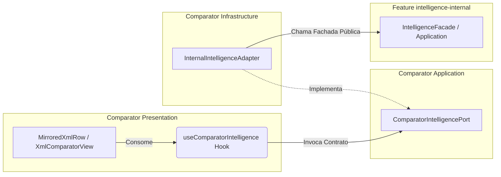

# Especificação Técnica de Pré-Implantação: Integração XML Comparator ↔ intelligence-internal

> **Documento Soberano de Engenharia e Pré-Implantação**  
> **Referência Técnica Primária**: [`docs/xml-comparator-intelligence-impact-report.md`](./xml-comparator-intelligence-impact-report.md)  
> **Data**: 2026-10-06  
> **Status**: PRÉ-IMPLANTAÇÃO APROVADA (Somente Especificação Técnica — Zero Implementação)  
> **Workspace**: `WorkTools2` (`labtool`)  
> **Features Envolvidas**: `src/features/xml-comparator` ↔ `src/features/intelligence-internal`

---

## 1. Objetivo da Documentação

Este documento estabelece o guia formal, canônico e detalhado de pré-implantação para a integração entre a ferramenta existente **XML Comparator** e a nova feature independente **intelligence-internal**.

Seu propósito é permitir que qualquer engenheiro de software ou agente autônomo execute a implementação futura de ponta a ponta sem necessidade de reanalisar a arquitetura, sem tomar decisões ad hoc e com total garantia de proteção das invariantes existentes.

---

## 2. O Problema a Resolver e Comportamento Esperado

### 2.1. O Problema
Atualmente, o XML Comparator detecta com alta precisão diferenças textuais e estruturais entre dois arquivos XML fiscais (um considerado Aprovado e outro Rejeitado). No entanto:
- O usuário visualiza que um `<CEP>` ou `<CNPJ>` difere entre os dois documentos, mas não sabe se o valor do XML rejeitado é inválido, inexistente ou se pertence a outra entidade legítima;
- O usuário não tem como conferir se uma tag `<CNAE>` pertence de fato ao CNPJ daquela empresa ou se consta como primária/secundária;
- Consultas manuais externas (em navegadores ou ferramentas avulsas) quebram o fluxo de trabalho local e aumentam o risco de erro humano.

### 2.2. O Comportamento Esperado
- Ao analisar duas notas fiscais com divergências, o Comparator identifica as tags que possuem capacidade de validação contextual;
- Um micro-botão discreto e sóbrio (`Validar [TAG]`, ex.: `Validar CEP`) surge no final da linha específica de cada documento;
- A validação **não ocorre automaticamente** ao carregar arquivos nem ao clicar em linhas aleatórias. Ela é estritamente disparada pelo clique explícito do operador;
- A nova feature `intelligence-internal` analisa o caminho posicional da tag, determina a qual entidade ela pertence (ex.: Tomador vs Prestador), efetua a consulta externa e devolve o resultado estruturado;
- O resultado é exibido como evidência cadastral complementar no painel de detalhes do Comparator, sem alterar o diff nem substituir o resultado do motor de comparação.

---

## 3. Princípio Central da Arquitetura e Limites das Features

```text
┌──────────────────────────────────────────────┐       ┌──────────────────────────────────────────────┐
│             XML COMPARATOR                   │       │            INTELLIGENCE-INTERNAL             │
│                                              │       │                                              │
│ • Parsing defensivo e fail-stop XXE          │       │ • Resolução de papéis (TOMADOR, EMITENTE...) │
│ • Árvore hierárquica e paths posicionais     │       │ • Detecção determinística de capabilities    │
│ • Diff estrutural determinístico             │  ◄──► │ • Validação cadastral (CEP, CNPJ, CNAE...)  │
│ • Alinhamento espelhado lado a lado (LCS)    │       │ • Mapeamento para entidades de domínio       │
│ • Seleção, scroll e painel de detalhes       │       │ • Gateways e adaptadores externos (BrasilAPI)│
│                                              │       │ • Cache de infraestrutura                    │
└──────────────────────────────────────────────┘       └──────────────────────────────────────────────┘
```

### Regras Inegociáveis de Fronteira:
1. **O XML Comparator NÃO valida dados cadastrais**: Ele fornece exclusivamente dados estruturais brutos (`tag`, `value`, `xmlPath`, `side`).
2. **A feature intelligence-internal NÃO realiza comparação de XMLs**: Ela recebe uma requisição contextual e avalia sua consistência cadastral.
3. **Desacoplamento Absoluto da BrasilAPI**: É terminantemente proibido qualquer import ou chamada a APIs externas dentro de componentes React ou do domínio do Comparator.

---

## 4. Camada de Comunicação no XML Comparator (Port & Adapter)

Para impedir o acoplamento direto entre os componentes visuais do Comparator e a implementação interna de `intelligence-internal`, adota-se o padrão **Port & Adapter (Hexagonal)**:



### Contratos e Responsabilidades:
- **`ComparatorIntelligencePort` (Application)**: Contrato abstrato que define `checkCapability(input)` e `validate(request)`. Não depende de bibliotecas externas nem da pasta de `intelligence-internal`.
- **`InternalIntelligenceAdapter` (Infrastructure)**: Implementação concreta localizada dentro de `xml-comparator/infrastructure/` que importa a fachada pública de `intelligence-internal` e adapta os dados.
- **O que essa camada NÃO pode fazer**: Não pode alterar a lista de diffs, não pode modificar o alinhamento de linhas do viewer e não pode invocar rede síncrona dentro da renderização.

---

## 5. Requisito Crítico: Contexto da Entidade

Uma tag XML fiscal **nunca** tem significado completo por si só. Um `<CNPJ>` ou `<CEP>` isolado não informa quem é o responsável pela informação:

```xml
<!-- Exemplo 1: Tomador do Serviço -->
<toma>
  <CNPJ>11222333000181</CNPJ>
  <end>
    <CEP>85900000</CEP>
  </end>
</toma>

<!-- Exemplo 2: Prestador do Serviço -->
<prest>
  <CNPJ>99888777000100</CNPJ>
  <end>
    <CEP>01001000</CEP>
  </end>
</prest>
```

### Resolução pelo Caminho Posicional Canônico (`xmlPath`)
O Comparator já extrai e disponibiliza o caminho XPath canônico determinístico 1-based:
- `/NFSe[1]/infDPS[1]/toma[1]/end[1]/CEP[1]` -> Ancestral `toma` indica **TOMADOR**.
- `/NFSe[1]/infDPS[1]/prest[1]/CNPJ[1]` -> Ancestral `prest` indica **PRESTADOR**.
- `/NFe[1]/infNFe[1]/emit[1]/enderEmit[1]/CEP[1]` -> Ancestral `emit` indica **EMITENTE**.

---

## 6. Papéis de Entidade (`EntityRole`)

Os papéis canônicos suportados inicialmente são:
1. `TOMADOR`: Tomador de serviço, destinatário da mercadoria, cliente (`toma`, `tomador`, `dest`, `destinatario`, `tomadorservico`).
2. `PRESTADOR`: Prestador do serviço, fornecedor, executor (`prest`, `prestador`, `prestadorservico`).
3. `EMITENTE`: Emitente fiscal do documento, remetente (`emit`, `emitente`, `rem`, `remetente`).
4. `INTERMEDIARIO`: Intermediário da operação (`interm`, `intermediario`).
5. `UNKNOWN`: Sem evidência estrutural inequívoca.

> [!IMPORTANT]
> **Definição Canônica de `UNKNOWN`**:  
> `UNKNOWN` **NÃO é um estado de erro**. Significa apenas ausência de evidência posicional suficiente no XML.  
> O sistema **nunca deve adivinhar** nem assumir premissas arbitrárias. Se o papel for `UNKNOWN`, a inteligência deve reportar apenas a validação sintática do campo (ex.: formato numérico de CNPJ ou CEP) ou indicar que falta contexto para validação cadastral relacional (como CNAE).

---

## 7. Isolamento Estrito entre Lado Aprovado e Lado Rejeitado (Side Isolation)

> [!CAUTION]
> **INVARIANTE DE SEGURANÇA E DOMÍNIO:**  
> O XML aprovado e o XML rejeitado são documentos legalmente autônomos.  
> Uma divergência pode decorrer de prestadores completamente diferentes ou tomadores não relacionados.  
> **É ESTRITAMENTE PROIBIDO utilizar dados do XML aprovado para validar informações do XML rejeitado, ou vice-versa.**

### Regras de Isolamento:
1. Toda requisição de validação (`ValidationRequest`) deve conter obrigatoriamente a propriedade `side: "approved" | "rejected"`.
2. Se o usuário clicar em `Validar CNAE` na coluna do XML rejeitado, o `EntityContextResolver` deve buscar o CNPJ da entidade **exclusivamente na subárvore do XML rejeitado**.
3. O cache de validações deve indexar os resultados por chave composta contendo o lado: `[side]:[path]:[value]`.

---

## 8. Capability Check (`checkCapability`)

A checagem de capacidade é a rotina responsável por informar à UI se determinado elemento divergente pode receber ação de validação.

### Características Obrigatórias:
- **100% Síncrona e Local**: Executada em memória com complexidade $O(1)$.
- **Zero I/O**: Proibido realizar requisições HTTP, acesso a disco ou timers.
- **Determinística**: Mesmos argumentos (`tag`, `path`, `side`, `value`) produzem rigorosamente a mesma saída.
- **Sem Efeitos Colaterais**: Não dispara estados de loading globais nem mutações de dados.

### Matriz Inicial de Capacidades:
| Tag Normalizada | Papel da Entidade | Tem Capability? | Label do Botão | Motivo |
| :--- | :--- | :---: | :--- | :--- |
| `cep` | Qualquer | **SIM** | `Validar CEP` | Consulta existência de CEP e endereço associado. |
| `cnpj` | Qualquer | **SIM** | `Validar CNPJ` | Valida DV e consulta situação na Receita. |
| `cnae` | Conhecido (`toma`, `prest`...) | **SIM** | `Validar CNAE` | Valida pertinência com atividades do CNPJ da entidade. |
| `cnae` | `UNKNOWN` (sem CNPJ) | **NÃO** | - | Não há como conferir CNAE sem CNPJ vinculado. |
| `vserv`, `vissqn`, `cst` | Qualquer | **NÃO** | - | Tags financeiras e tributárias sem validação cadastral externa nesta fase. |

---

## 9. Execução da Validação (`validate`)

A validação é assíncrona e executada **somente** após interação intencional do usuário.

```text
[Divergência Renderizada] 
         │
         ▼
[Linha exibe: Validar CEP] 
         │
         ▼ (Clique do Usuário)
[Dispara useComparatorIntelligence.executeValidation(request)]
         │
         ▼ (Estado local da linha muda para 'loading')
[Intelligence: EntityContextResolver extrai contexto da entidade no lado correto]
         │
         ▼
[Validator Use Case orquestra verificação de domínio e gateway]
         │
         ▼
[Retorno de ValidationResult] 
         │
         ▼
[Exibe status e detalhes no ComparatorDiffDetails]
```

---

## 10. Comportamento e Extensão Visual no XML Comparator

### 10.1. Ponto de Inserção: `MirroredXmlRow.tsx`
O arquivo [`MirroredXmlRow.tsx`](../labtool/src/features/xml-comparator/presentation/MirroredXmlRow.tsx) renderiza as células independentes do XML aprovado (célula esquerda) e do XML rejeitado (célula direita).

O micro-botão `ValidateTagAction` será inserido ao final do conteúdo da tag ou logo após o texto, alinhado à direita antes do badge de tipo de diff:
- **Aparência**: Estilo Catppuccin Mocha, fonte JetBrains Mono, padding sóbrio (`1px 6px`), borda discreta de 1px, sem efeitos extravagantes;
- **Comportamento**: Ao clicar, invoca `e.stopPropagation()` para não disparar a seleção de linha inteira;
- **Feedback**: Mostra micro-spinner ou texto `Validando...` enquanto a consulta assíncrona estiver pendente.

### 10.2. Apresentação do Resultado: `ComparatorDiffDetails.tsx`
O resultado não deve ser injetado dentro da linha do código (para evitar colapso do alinhamento vertical da grid espelhada). Ele será apresentado na parte inferior do painel de detalhes da divergência selecionada ([`ComparatorDiffDetails.tsx`](../labtool/src/features/xml-comparator/presentation/ComparatorDiffDetails.tsx)), em um card dedicado `CadastralValidationResultCard`.

---

## 11. Regra de Negócio: Aprovado Não Significa Cadastralmente Correto

> [!NOTE]
> **REQUISITO FORMAL DE DOMÍNIO:**  
> O fato de um documento constar como "XML Aprovado" significa unicamente que ele foi aceito por determinado WebService fiscal sob determinadas condições no passado.  
> - O XML Aprovado **pode conter dados cadastrais defasados ou incorretos**.  
> - O XML Rejeitado **pode conter o dado cadastral correto** cuja rejeição decorreu de outro fator não correlato.  
> 
> A feature `intelligence-internal` nunca emitirá parecer determinando qual documento está "certo". Ela relata fatos cadastrais objetivos obtidos junto às bases oficiais (ex.: "CEP 85901000 ativo no município de Toledo-PR").

---

## 12. Escopo das Capacidades Iniciais

### 1. CNPJ (`cnpj-validator.usecase.ts`)
- Normalização para 14 dígitos numéricos;
- Validação algorítmica de Dígitos Verificadores (DV);
- Consulta da situação cadastral (Ativa, Baixada, Suspensa, Inapta);
- Razão Social, Nome Fantasia, CNAE Primário e CNAEs Secundários;
- Endereço cadastrado na Receita Federal.

### 2. CEP (`cep-validator.usecase.ts`)
- Normalização para 8 dígitos numéricos;
- Consulta de existência da faixa de CEP;
- Extração de UF, Município, Bairro e Logradouro;
- Confronto com tags irmãs de endereço no XML do mesmo lado (`<xMun>`, `<UF>`, `<xLgr>`).

### 3. CNAE (`cnae-validator.usecase.ts`)
- Normalização numérica de 7 dígitos;
- Resolução do CNPJ pertencente à mesma entidade no mesmo documento;
- Verificação se o código consta no cadastro da empresa;
- Identificação se é Atividade Principal ou Secundária;
- Se o CNPJ da entidade não for localizado no mesmo lado, relatar status `UNRESOLVED_ENTITY_CNPJ`.

---

## 13. Arquitetura da Nova Feature: `intelligence-internal`

A estrutura proposta organiza-se estritamente sob os preceitos de Clean Architecture:

```text
src/features/intelligence-internal/
├── domain/                                  [ESSENCIAL - FASE 1]
│   ├── entity-context.types.ts              (Tipos puros: EntityRole, EntityContext)
│   ├── validation-capability.types.ts       (Tipos puros: CapabilityCheckInput, CapabilityResult)
│   ├── validation-result.types.ts           (Contrato do resultado estruturado da validação)
│   └── index.ts
│
├── application/                             [ESSENCIAL - FASES 1 E 2]
│   ├── entity-context-resolver.ts           (Mapeia caminhos XPath para papéis e dados da entidade)
│   ├── capability-checker.ts                (Algoritmo determinístico local de capacidades)
│   ├── ports/
│   │   ├── cadastral-gateway.port.ts        (Interface abstrata de consulta cadastral)
│   │   └── cep-gateway.port.ts              (Interface abstrata de consulta de CEP)
│   ├── validators/                          [FASES 6, 7 E 8]
│   │   ├── cnpj-validator.usecase.ts
│   │   ├── cep-validator.usecase.ts
│   │   └── cnae-validator.usecase.ts
│   └── index.ts
│
├── infrastructure/                          [FASES 3 E 5]
│   ├── brasil-api/
│   │   ├── brasil-api-cadastral.client.ts   (Cliente HTTP defensivo BrasilAPI v1/v2)
│   │   ├── brasil-api-cadastral.mapper.ts   (Mapeador de respostas BrasilAPI para tipos internos)
│   │   └── brasil-api-cadastral.types.ts    (Tipos brutos das APIs externas)
│   ├── memory/
│   │   └── in-memory-cadastral.cache.ts     (Cache volátil por chave composta)
│   └── index.ts
│
└── index.ts                                 [ESSENCIAL - FASE 1] (Fachada pública da feature)
```

---

## 14. Arquivos do Comparator Impactados

| Arquivo | Responsabilidade Atual | Alteração Prevista | Dependências Permitidas | Dependências Proibidas | Risco |
| :--- | :--- | :--- | :--- | :--- | :---: |
| [`MirroredXmlRow.tsx`](../labtool/src/features/xml-comparator/presentation/MirroredXmlRow.tsx) | Renderização das células das linhas de ambos os lados. | Inserir slot visual para renderizar `ValidateTagAction` ao final da célula de cada lado. | Componentes internos do Comparator, `ValidateTagAction`. | Proibido importar `intelligence-internal` ou `fetch`. | MÉDIO |
| [`MirroredXmlViewer.tsx`](../labtool/src/features/xml-comparator/presentation/MirroredXmlViewer.tsx) | Scroll container e layout de colunas espelhadas. | Repassar props e callbacks de validação para as linhas filhas. | Tipos locais do Comparator. | Proibido acoplar regras de inteligência. | BAIXO |
| [`ComparatorDiffDetails.tsx`](../labtool/src/features/xml-comparator/presentation/ComparatorDiffDetails.tsx) | Detalhes e metadados da divergência selecionada. | Incluir seção/card para exibição dos resultados da validação cadastral. | Tipos locais do Comparator, `ValidationResult`. | Proibido invocar requisições HTTP ou mutações diretas. | BAIXO |
| [`XmlComparatorView.tsx`](../labtool/src/features/xml-comparator/presentation/XmlComparatorView.tsx) | Orquestrador de estado e layout principal do Comparator. | Integrar hook `useComparatorIntelligence` e gerenciar estado das validações ativas. | Hooks do Comparator, porta de inteligência. | Proibido acoplar implementações concretas de APIs externas. | MÉDIO |
| [`application/index.ts`](../labtool/src/features/xml-comparator/application/index.ts) | Exportações públicas da camada de aplicação do Comparator. | Exportar os contratos da porta de inteligência (`ComparatorIntelligencePort`). | Nenhuma dependência externa. | Proibido exportar detalhes da infraestrutura. | BAIXO |

---

## 15. Arquivos Protegidos do XML Comparator (`[MANTER — SEM ALTERAÇÃO]`)

Os oito artefatos a seguir compõem o núcleo estável e verificado do XML Comparator. **É expressamente proibido alterá-los:**
1. [`src/features/xml-comparator/domain/comparison.types.ts`](../labtool/src/features/xml-comparator/domain/comparison.types.ts): Modelo e invariantes de divergência puros.
2. [`src/features/xml-comparator/domain/export.types.ts`](../labtool/src/features/xml-comparator/domain/export.types.ts): Tipos de exportação neutros.
3. [`src/features/xml-comparator/application/comparator-parser.ts`](../labtool/src/features/xml-comparator/application/comparator-parser.ts): Parsing DOMParser, guards XXE e caminhos posicionais.
4. [`src/features/xml-comparator/application/xml-differ.ts`](../labtool/src/features/xml-comparator/application/xml-differ.ts): Algoritmo de diff estrutural e árvore normalizada.
5. [`src/features/xml-comparator/application/diff-classifier.ts`](../labtool/src/features/xml-comparator/application/diff-classifier.ts): Regras semânticas de classificação de divergências.
6. [`src/features/xml-comparator/application/diff-context.ts`](../labtool/src/features/xml-comparator/application/diff-context.ts): Resolução de linhas de visualização e nós pais.
7. [`src/features/xml-comparator/presentation/mirrored-rows.ts`](../labtool/src/features/xml-comparator/presentation/mirrored-rows.ts): Algoritmo LCS de alinhamento de linhas espelhadas.
8. [`src/features/xml-comparator/application/export-sanitizer.ts`](../labtool/src/features/xml-comparator/application/export-sanitizer.ts) e [`markdown-exporter.ts`](../labtool/src/features/xml-comparator/application/markdown-exporter.ts): Mecanismo de exportação com sanitização de PIIs.

---

## 16. Tabela Crítica dos Novos Arquivos Propostos

| Arquivo Proposto | Camada | Responsabilidade | Fase | Classificação | Justificativa / Risco de Overengineering |
| :--- | :--- | :--- | :---: | :---: | :--- |
| `xml-comparator/application/ports/comparator-intelligence.port.ts` | Port | Contrato abstrato de comunicação | Fase 4 | **ESSENCIAL** | Necessário para desacoplar a UI da feature de inteligência. |
| `xml-comparator/infrastructure/internal-intelligence.adapter.ts` | Adapter | Adaptador chamando a fachada de inteligência | Fase 4 | **ESSENCIAL** | Ponte concreta que implementa o Port. |
| `xml-comparator/presentation/hooks/useComparatorIntelligence.ts` | Presentation | Hook React de controle de estado e cache | Fase 4 | **ESSENCIAL** | Isola estados assíncronos fora dos componentes de renderização. |
| `xml-comparator/presentation/components/ValidateTagAction.tsx` | Presentation | Micro-botão sóbrio de disparo | Fase 5 | **ESSENCIAL** | Elemento visual pontual e de baixo impacto no grid. |
| `intelligence-internal/domain/entity-context.types.ts` | Domain | Tipos de papéis de entidade | Fase 1 | **ESSENCIAL** | Fundação do contexto semântico. |
| `intelligence-internal/domain/validation-capability.types.ts` | Domain | Contratos de capability | Fase 1 | **ESSENCIAL** | Define a checagem rápida local. |
| `intelligence-internal/domain/validation-result.types.ts` | Domain | Contrato do resultado estruturado | Fase 1 | **ESSENCIAL** | Tipagem do retorno da validação. |
| `intelligence-internal/application/entity-context-resolver.ts` | Application | Dedução do papel da entidade via path | Fase 2 | **ESSENCIAL** | Núcleo de inteligência posicional de XML. |
| `intelligence-internal/application/capability-checker.ts` | Application | Decisor síncrono de tags validáveis | Fase 2 | **ESSENCIAL** | Algoritmo que liga tag + path ao botão. |
| `intelligence-internal/infrastructure/brasil-api/brasil-api-cadastral.client.ts`| Infra | Cliente HTTP defensivo BrasilAPI | Fase 3 | **ESSENCIAL** | Conexão externa protegida com timeout e abort signal. |
| `intelligence-internal/infrastructure/memory/in-memory-cadastral.cache.ts` | Infra | Cache volátil em memória | Fase 3 | **ESSENCIAL** | Evita múltiplos cliques gerando 429 na BrasilAPI. |
| `intelligence-internal/application/validators/cep-validator.usecase.ts` | Application | Caso de uso de validação de CEP | Fase 6 | **ESSENCIAL** | Primeira capacidade funcional entregue. |
| `intelligence-internal/application/validators/cnpj-validator.usecase.ts` | Application | Caso de uso de validação de CNPJ | Fase 7 | **ESSENCIAL** | Segunda capacidade funcional entregue. |
| `intelligence-internal/application/validators/cnae-validator.usecase.ts` | Application | Caso de uso de validação de CNAE | Fase 8 | **ESSENCIAL** | Terceira capacidade funcional entregue. |
| `intelligence-internal/infrastructure/brasil-api/brasil-api-cadastral.mapper.ts` | Infra | Mapeamento de DTOs da BrasilAPI | Fase 3 | **ESSENCIAL** | Traduz formatos externos para o domínio. |
| `intelligence-internal/domain/validator-registry.ts` | Domain | Registro dinâmico de validadores | Futuro | **ADIAR** | Inicialmente, o despachante estático em `capability-checker` é suficiente e mais simples. |
| `intelligence-internal/infrastructure/persistence/storage-cache.ts` | Infra | Cache persistente em IndexedDB/LocalStorage | Futuro | **ADIAR** | Cache em memória de sessão resolve 100% dos requisitos imediatos sem overhead. |

---

## 17. Contratos Conceituais Previstos

### 17.1. Papel e Contexto da Entidade
```typescript
export type EntityRole =
  | "TOMADOR"
  | "PRESTADOR"
  | "EMITENTE"
  | "INTERMEDIARIO"
  | "UNKNOWN";

export interface EntityContext {
  role: EntityRole;
  entityTag: string; // ex.: "toma", "emit", "prest"
  cnpj?: string;
  cpf?: string;
  razaoSocial?: string;
  municipio?: string;
  uf?: string;
}
```

### 17.2. Checagem de Capacidade
```typescript
export interface CapabilityCheckInput {
  tag: string;
  path: string;
  side: "approved" | "rejected";
  value: string | null;
}

export interface CapabilityCheckResult {
  canValidate: boolean;
  targetType?: "CEP" | "CNPJ" | "CNAE";
  label?: string; // ex.: "Validar CEP", "Validar CNPJ"
}
```

### 17.3. Requisição e Resultado da Validação
```typescript
export interface ValidationRequest {
  tag: string;
  value: string;
  path: string;
  side: "approved" | "rejected";
  fullXmlSource?: string; // Para buscar dados correlatos da entidade no mesmo lado
}

export type ValidationStatus =
  | "VALID"
  | "INVALID"
  | "INCONSISTENT"
  | "NOT_FOUND"
  | "UNRESOLVED_ENTITY"
  | "EXTERNAL_ERROR"
  | "RATE_LIMITED"
  | "TIMEOUT";

export interface ValidationResult {
  id: string;
  timestamp: string;
  tag: string;
  value: string;
  side: "approved" | "rejected";
  entity: EntityContext;
  status: ValidationStatus;
  summary: string;
  details?: Record<string, unknown>;
  source: "BRASIL_API" | "LOCAL_RULES";
}
```

---

## 18. Matriz Completa de Riscos e Mitigações

| Risco | Impacto | Probabilidade | Mitigação Arquitetural | Fase de Tratamento |
| :--- | :---: | :---: | :--- | :---: |
| **Contaminação de dados entre Aprovado e Rejeitado** | **CRÍTICO** | MÉDIA | Propriedade `side` obrigatória em todo o fluxo; resolvedor busca dados correlatos estritamente na subárvore daquele lado. | Fase 1 e Fase 2 |
| **Acoplamento direto da UI ou Comparator à BrasilAPI** | **CRÍTICO** | BAIXA | Proibição de chamadas `fetch` fora de `infrastructure`; isolamento por porta e adaptador. | Fase 3 e Fase 4 |
| **Bloqueio de IP por Rate Limit (HTTP 429)** | **ALTO** | ALTA | Proibição de requests automáticos; chamadas exclusivas por clique; cache em memória indexado por valor e lado. | Fase 3 e Fase 5 |
| **Falsos positivos na identificação de entidades** | **ALTO** | MÉDIA | Classificação estrita por segmentos de path; se houver dúvida ou falta de evidência estrutural, assumir `UNKNOWN`. | Fase 2 |
| **Quebra de layout ou altura de linha no visualizador** | **MÉDIO** | BAIXA | Botão sóbrio e compacto (`ValidateTagAction`); exibição detalhada de resultados alocada no rodapé inferior (`ComparatorDiffDetails`). | Fase 5 |
| **Regressão nos testes existentes do Comparator** | **ALTO** | BAIXA | 8 arquivos centrais totalmente protegidos e intocados; execução obrigatória de `npm test` a cada fase. | Todas as Fases |
| **Lentidão ou indisponibilidade temporária da BrasilAPI** | **MÉDIO** | MÉDIA | Timeout rigoroso de 10s via `AbortController`; mensagens de status amigáveis sem travamento da interface. | Fase 3 |

---

## 19. Estratégia e Plano de Testes

### 19.1. Testes Unitários de Domínio e Aplicação
- Testar `EntityContextResolver` com amostras reais de NFe, CTe e múltiplos layouts de NFSe (Padrão Nacional, ABRASF, SP, RJ, Curitiba);
- Garantir que caminhos fora de blocos de tomador/prestador retornem `role: "UNKNOWN"`;
- Testar `CapabilityChecker` verificando que tags não cadastradas retornam `canValidate: false` em < 1ms.

### 19.2. Testes de Isolamento de Lados
- Fornecer dois XMLs fictícios com empresas distintas no Aprovado e Rejeitado;
- Disparar validação de CNAE para o lado Rejeitado e assegurar formalmente que o CNPJ consultado pertenceu ao Rejeitado.

### 19.3. Testes de Infraestrutura (Mock de Rede)
- Simular retorno HTTP 200 (sucesso cadastral);
- Simular retorno HTTP 404 (CNPJ ou CEP não encontrado);
- Simular retorno HTTP 429 (Rate Limit excedido);
- Simular timeout de rede por abort signal após 10s.

### 19.4. Testes de Regressão Obrigatórios
- Executar os 12 arquivos de teste de `labtool/tests/features/xml-comparator/`;
- 100% dos testes devem permanecer aprovados sem alterações em suas asserções.

---

## 20. Fases Sequenciais de Implantação

```text
FASE 1: Núcleo de Domínio de intelligence-internal (Types puros, sem UI e sem HTTP)
   ↓
FASE 2: Application Core (EntityContextResolver e CapabilityChecker determinístico)
   ↓
FASE 3: Infraestrutura de Integração (BrasilApiClient defensivo e Cache em memória)
   ↓
FASE 4: Integração no Comparator (Port, Adapter e useComparatorIntelligence hook)
   ↓
FASE 5: Extensões Visuais Sóbrias (MirroredXmlRow e ComparatorDiffDetails)
   ↓
FASE 6: Capacidade Completa de CEP (Use case, validações e teste e2e)
   ↓
FASE 7: Capacidade Completa de CNPJ (Use case, validações e teste e2e)
   ↓
FASE 8: Capacidade Completa de CNAE (Use case relacional CNPJ+CNAE e teste e2e)
   ↓
FASE 9: Consolidação Final, Quality Gates Mecânicos e Validação Global
```

### Regras de Interrupção por Fase:
Se qualquer teste regredir, se o TypeScript apresentar erros ou se for detectada dependência circular entre features, a implementação da fase deve ser **imediatamente interrompida e corrigida** antes de avançar para a fase subsequente.

---

## 21. Quality Gates Mecânicos e Critérios de Aceite

### Critérios de Aceite Globais:
1. O usuário visualiza o micro-botão `Validar [TAG]` apenas nas tags suportadas;
2. O botão funciona de forma autônoma para a coluna do XML aprovado e do XML rejeitado;
3. O carregamento de arquivos XML nunca gera tráfego de rede automático;
4. O clique executa a consulta e renderiza o resultado cadastral estruturado no rodapé;
5. Erros de rede (404, 429, timeout) são reportados com clareza sem travar o comparador;
6. A ferramenta pode ser utilizada totalmente offline para comparação estrutural padrão;
7. Todos os testes passam: `npm test` e `npm run validate` com zero erros.

---

## 22. Estratégia de Rollback

A integração foi desenhada com acoplamento fraco e aditivo:
- Se a feature `intelligence-internal` for desabilitada ou seus arquivos forem removidos, o XML Comparator continuará funcionando perfeitamente;
- O hook `useComparatorIntelligence` pode operar em modo stub (retornando `canValidate: false` para todas as tags), desativando todos os botões visuais sem demandar refatoração de código;
- Nenhuma alteração no esquema de diff ou nas estruturas de dados do comparator depende da existência de `intelligence-internal`.

---

## 23. Decisões Arquiteturais Consolidadas e Abertas

### Decisões Confirmadas:
1. `intelligence-internal` é uma feature completamente desacoplada;
2. `xml-comparator` interage via padrão Port & Adapter;
3. `checkCapability` é estritamente síncrono e local;
4. `validate` ocorre exclusivamente mediante clique do usuário;
5. XML Aprovado e XML Rejeitado são independentes e nunca compartilham dados;
6. Os 8 arquivos centrais do Comparator estão formalmente congelados e protegidos;
7. O resultado da validação é evidência complementar, sem alterar o status do diff.

### Decisões Abertas (Para Decisão na Fase 3):
1. **Compartilhamento de Cache entre Sessões**: Inicialmente o cache será volátil em memória. Na Fase 3, decidir se vale persistir em `sessionStorage` para reter consultas entre recargas de página.
2. **Filas de Concorrência**: Avaliar na Fase 3 se deve ser incluído um rate limiter de cliente (máximo de 2 requisições por segundo para a BrasilAPI).

---

## 24. Checklist Executivo de Pré-Implantação

- [x] Relatório arquitetural de impacto concluído e aprovado.
- [x] Fronteiras de responsabilidade entre as features rigorosamente delimitadas.
- [x] 8 arquivos protegidos do Comparator catalogados e congelados.
- [x] Invariante de isolamento de lados (`approved` vs `rejected`) estabelecida.
- [x] Papéis de entidade e tratamento semântico de `UNKNOWN` definidos.
- [x] Contratos previstos de porta, requisição e resultado formalizados.
- [x] Estratégia de zero chamadas automáticas à BrasilAPI consolidada.
- [x] Risco de quebra de layout no visualizador espelhado mitigado.
- [x] 9 fases sequenciais de implantação com critérios de interrupção estabelecidos.
- [x] Estratégia de testes unitários, isolamento e regressão definida.
- [x] Plano de rollback e desativação sem perda do comparador validado.
